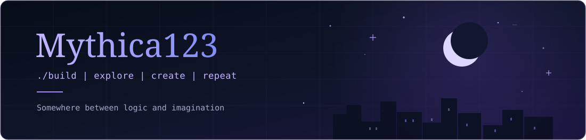

<!-- Mythica123 Profile --->

<div align="center">
<picture>
    <source media="(prefers-color-scheme: dark)" srcset="./assets/header.svg">
    
</picture>
</div>

<br>

## 

```yaml
username: Mythica123
focus: Building software
currently:
    - Working on full-stack applications
    - Exploring new ideas and tools
    - Learning along the way
```

---

## 


<table width="100%">
<tr>
    <!-- Left Column -->
    <td width="48%" valign="top">
        <!-- 01 Languages -->
        
        <p>
            
            &nbsp;&nbsp;
            
            &nbsp;&nbsp;
            
            &nbsp;&nbsp;
            
            &nbsp;&nbsp;
             
        </p>
        <sub>Python · Java · TypeScript · JavaScript · C</sub>
        <br><br>
        <br><br>
        <!-- 03 Backend & Databases -->
        
        <p>
            
            &nbsp;&nbsp;&nbsp;&nbsp;
            <picture>
                <source media="(prefers-color-scheme: dark)" srcset="./assets/icons/express-white.svg"/>
                
            </picture>
            &nbsp;&nbsp;&nbsp;&nbsp;
            
            &nbsp;&nbsp;&nbsp;&nbsp;
            
        </p>
        <sub>Node.js · Express.js · Supabase · PostgreSQL</sub>
    </td>
    <td width="4%"></td>
    <!-- Right Column -->
    <td width="48%" valign="top">
        <!-- 02 Frontend -->
        
        <p>
            
            &nbsp;&nbsp;&nbsp;&nbsp;
            
            &nbsp;&nbsp;&nbsp;&nbsp;
            
            &nbsp;&nbsp;&nbsp;&nbsp;
            
        </p>
        <sub>React · Next.js · SvelteKit · TailwindCSS</sub>
        <br><br>
        <br><br>
        <!-- 04 Testing & Tools -->
        
        <p>
            
            &nbsp;&nbsp;&nbsp;&nbsp;
            
            &nbsp;&nbsp;&nbsp;&nbsp;
            
            &nbsp;&nbsp;&nbsp;&nbsp;
            
        </p>
        <sub>Playwright · Git · Jira · Zephyr</sub>
    </td>
</tr>
</table>

<br>

---

## 

<table width="100%">
<tr>

<td width="48%" valign="top">


<br>

<br>
<sub>Housing Connect</sub>

<br>
<p>A housing platform with roommate matching and real-time messaging, including unread message indicators and read status functionality.</p>

<sub>`SvelteKit` • `TypeScript` • `Supabase` • `PostgreSQL`</sub>

</td>

<td width="4%"></td>

<td width="48%" valign="top">


<br>


<sub>Event Discovery Platform</sub>

<p>An application for discovering local events, with search, past-event filtering, and role-based organizer management</p>

<sub>`TypeScript` • `Prisma` • `Jest` • `Tailwind CSS`</sub>

</td>

</tr>
</table>

<br>

<table width="100%">
<tr>
<td valign="top">


<br>


<sub>Hackathon Project</sub>

<p>An activity discovery and matching application featuring activity creation, authentication, and interactive functionality.</p>

<sub>`Next.js` • `React` • `TypeScript` • `Supabase`</sub>

</td>
</tr>
</table>

---

<div align="center">

<sub>✦ end of transmission ✦</sub>

<code>Mythica123</code>

</div>
